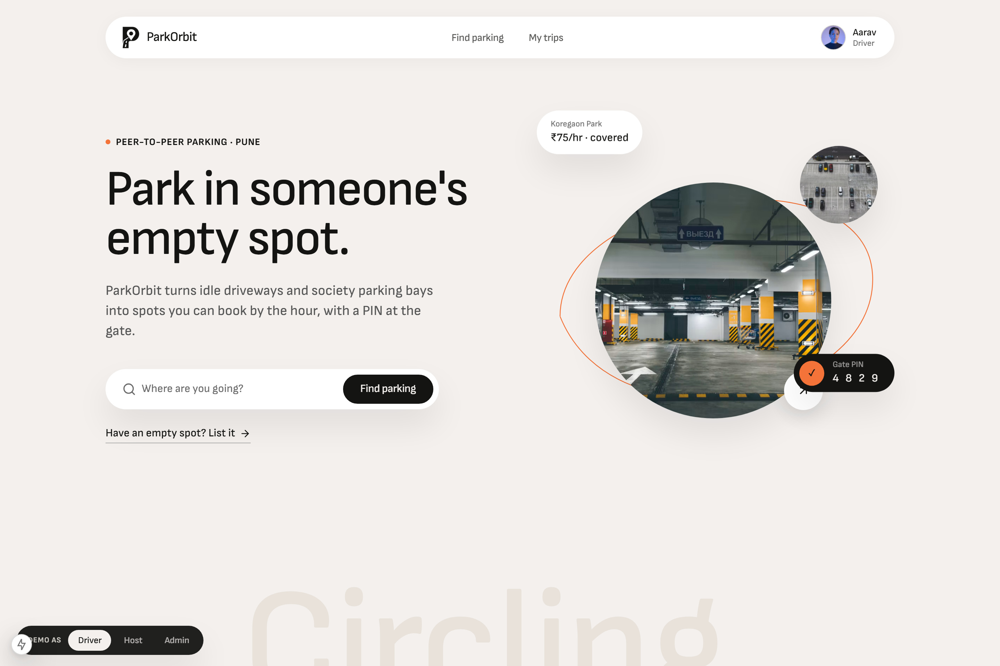
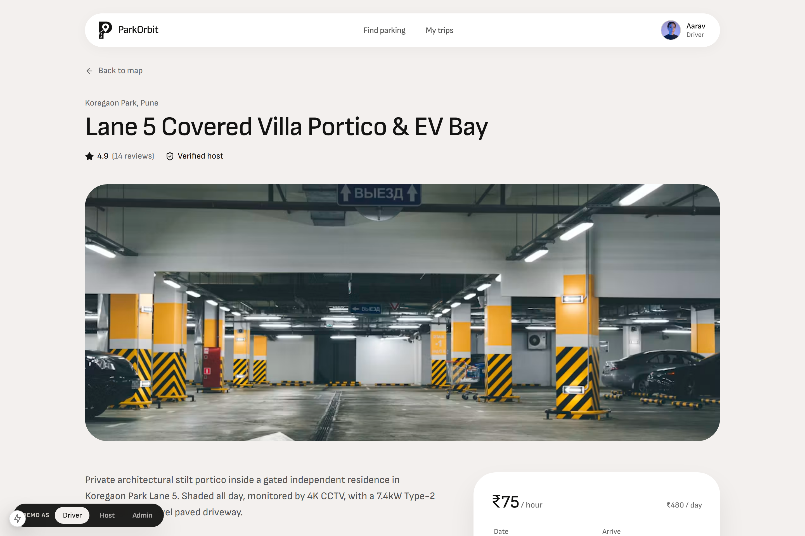
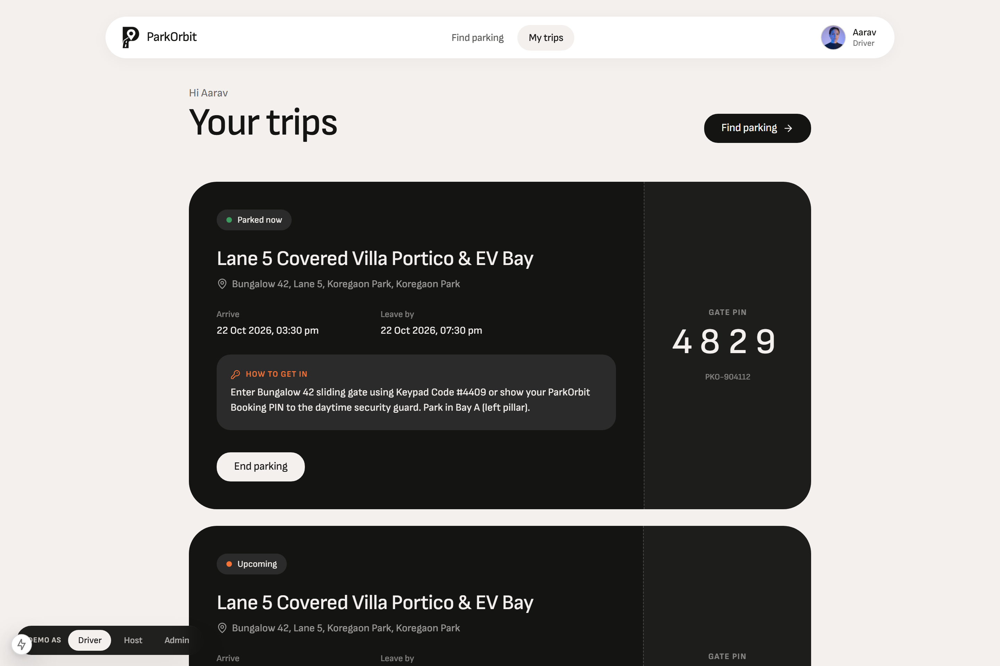
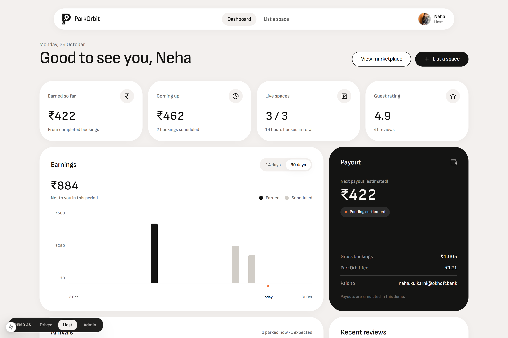
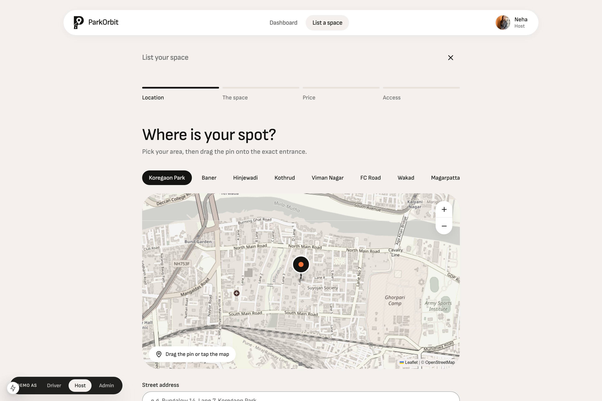
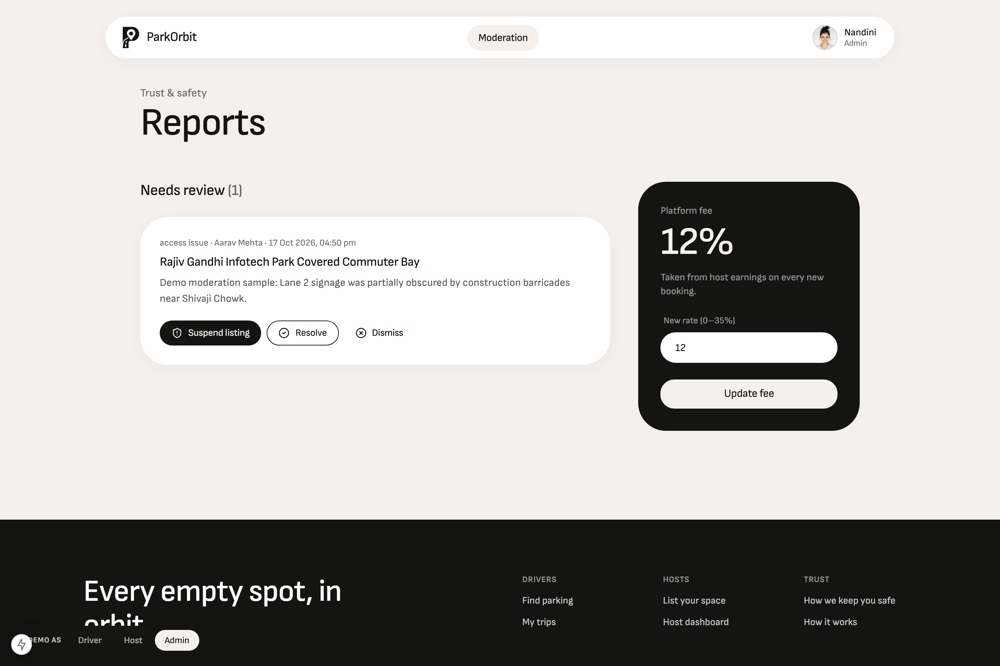
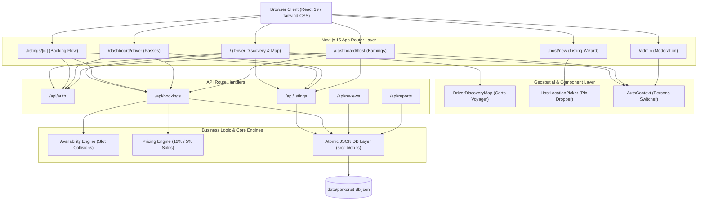
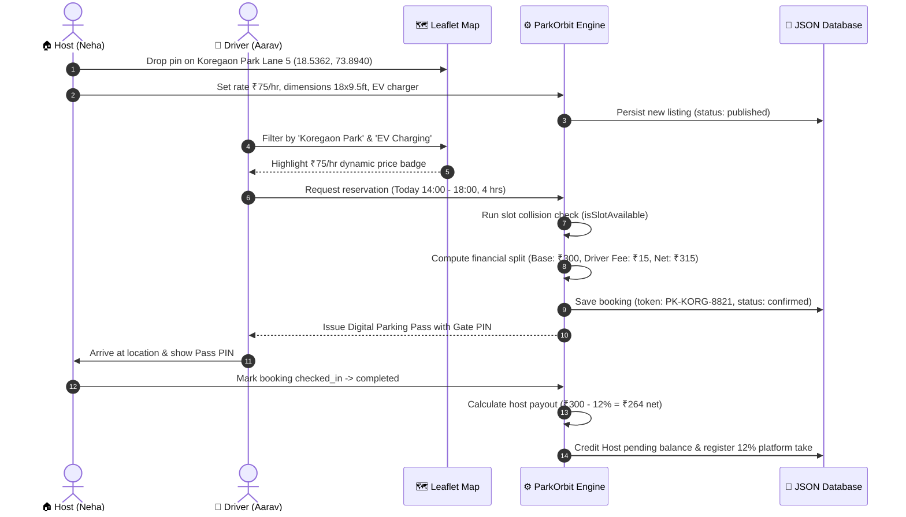

<div align="center">


# 🛰️ ParkOrbit

### **Hyper-Local Peer-to-Peer Parking Marketplace & Geospatial Urban Mobility Protocol**

[](https://nextjs.org/)
[](https://react.dev/)
[](https://www.typescriptlang.org/)
[](https://tailwindcss.com/)
[](https://leafletjs.com/)
[](https://vitest.dev/)
[](LICENSE)

<br/>

**Transforming dormant private driveways, residential stilt spaces, and commercial bays into guaranteed, high-efficiency parking nodes across Pune's busiest IT and commercial corridors.**

[Explore Features](#-core-feature-matrix) • [View Prototype UI](#-prototype-visual-tour) • [The Urban Impact](#-the-urban-crisis--market-impact) • [Architecture](#-system-architecture--technical-stack) • [Quickstart](#-quickstart--local-setup) • [Test Suite](#-testing--quality-engineering)

---

</div>

<br/>

## 📖 Table of Contents

- [🌟 Executive Overview](#-executive-overview)
- [💥 The Urban Crisis & Market Impact](#-the-urban-crisis--market-impact)
- [📸 Prototype Visual Tour](#-prototype-visual-tour)
  - [1. Real-Time Geospatial Discovery Engine](#1-real-time-geospatial-discovery-engine)
  - [2. Space Specification & Instant Booking Flow](#2-space-specification--instant-booking-flow)
  - [3. Driver Hub & Dynamic Digital Parking Pass](#3-driver-hub--dynamic-digital-parking-pass)
  - [4. Host Command Center & Revenue Telemetry](#4-host-command-center--revenue-telemetry)
  - [5. Interactive Pin-Drop Space Onboarding](#5-interactive-pin-drop-space-onboarding)
  - [6. Admin Trust, Safety & Dispute Mediation](#6-admin-trust-safety--dispute-mediation)
- [🎭 1-Click Multi-Persona Simulator](#-1-click-multi-persona-simulator)
- [⚡ Core Feature Matrix](#-core-feature-matrix)
- [🏗️ System Architecture & Technical Stack](#-system-architecture--technical-stack)
- [🔄 End-to-End Marketplace Flow](#-end-to-end-marketplace-flow)
- [📊 Marketplace Financial Engineering](#-marketplace-financial-engineering)
- [🗺️ Pune Geospatial Coverage & Boundary Model](#-pune-geospatial-coverage--boundary-model)
- [📁 Project Layout](#-project-layout)
- [🚦 Quickstart & Local Setup](#-quickstart--local-setup)
- [🌐 REST API Catalog](#-rest-api-catalog)
- [🧪 Testing & Quality Engineering](#-testing--quality-engineering)
- [🛣️ Production Roadmap](#-production-roadmap)
- [📄 License & Credits](#-license--credits)

---

## 🌟 Executive Overview

**ParkOrbit** is a peer-to-peer (P2P) urban parking marketplace platform engineered to alleviate severe metropolitan parking deficits and reduce curb-space congestion. Focused on the high-density economic corridors of **Pune, Maharashtra**, ParkOrbit bridges the divide between **hosts** (homeowners, housing societies, gated villas, and commercial property managers) who possess underutilized parking real estate, and **drivers** (daily commuters, EV owners, and weekend visitors) in search of safe, predictable, and cost-effective parking spots.

Powered by **Next.js 15 App Router**, **React 19**, and a zero-dependency **Leaflet + Carto Voyager** mapping layer, ParkOrbit replaces traditional paper receipts and frantic on-street cruising with real-time geospatial discovery, custom dynamic price badges, instant digital passes, transparent fee breakdowns, and a seamless 1-click multi-persona testing suite.

---

## 💥 The Urban Crisis & Market Impact

Urban vehicular growth across Indian Tier-1 metros has outpaced municipal infrastructure development by orders of magnitude. In dense hubs like Pune's **Hinjawadi IT Park**, **FC Road**, **Baner**, and **Koregaon Park**, parking is no longer an inconvenience—it is a critical economic and environmental bottleneck.

```
┌─────────────────────────────────────────────────────────────────────────────┐
│                       THE URBAN PARKING DEFICIT                             │
├──────────────────────────────┬──────────────────────────────┬───────────────┤
│ 🚗 30%+ Cruising Congestion │ ⏱️ 18-24 Min Search Time    │ 🌿 150 kg CO2 │
│ A third of core corridor    │ Average time commuters lose  │ Wasted carbon │
│ traffic is vehicles hunting │ every single day circling    │ per vehicle / │
│ for curbside slots.         │ blocks for parking.          │ year idling.  │
├──────────────────────────────┴──────────────────────────────┴───────────────┤
│                     THE UNTAPPED REAL ESTATE BUFFER                         │
├─────────────────────────────────────────────────────────────────────────────┤
│ 🏙️ 45-60% Idle Capacity: Residential villa carports, housing society bays, │
│ and private commercial decks sit empty while occupants are at work.         │
└─────────────────────────────────────────────────────────────────────────────┘
```

### Quantifiable Impact Delivered by ParkOrbit:
- **70% Reduction in Parking Search Latency**: Drivers navigate directly to their reserved, guaranteed bay with turn-by-turn geospatial coordinates, eliminating cruising.
- **Micro-Revenue Generation for Homeowners**: Hosts monetize idle asphalt, generating between **₹6,000 and ₹18,000/month** in passive recurring earnings per slot.
- **Lower Tailpipe Emissions**: Slashing cruising miles across Pune's arterial corridors cuts thousands of metric tons of localized PM2.5 and CO2 emissions.
- **EV Adoption Catalyst**: Dedicated filtering for 7.4kW and 22kW EV charging bays gives electric vehicle commuters guaranteed destination charging while they work.
- **Zero Municipal CapEx**: Rather than spending hundreds of crores constructing multi-level parking plazas, cities unlock thousands of private bays immediately through software.

---

## 📸 Prototype Visual Tour

Below are high-resolution captures from the live, fully functional prototype running in the local test environment.

### 1. Real-Time Geospatial Discovery Engine
> *The driver landing experience featuring interactive Leaflet maps with custom `₹/hr` HTML price pins, instant Pune locality filters, live search, and dynamic card synchronization.*

<div align="center">
  
</div>

- **Interactive Price Markers**: Custom `L.divIcon` markers displaying live rates (e.g., `₹45/hr`, `₹75/hr`, `₹90/hr`) directly on the map.
- **1-Click Pune Hub Filtering**: Jump instantly to Hinjawadi, Baner, Koregaon Park, Shivajinagar, Kothrud, or Viman Nagar.
- **Two-Way Viewport Synchronization**: Hovering or selecting any card pans and highlights the corresponding map pin in real time.

---

### 2. Space Specification & Instant Booking Flow
> *Comprehensive listing page showcasing multi-angle space photography, dimensional clearances, EV charging specifications, verified host badges, and transparent fee breakdown.*

<div align="center">
  
</div>

- **Architectural Dimensions**: Sizing metrics (length, width, vertical clearance) ensure large SUVs or roof-racked vehicles fit safely.
- **Security & Amenity Badging**: 24/7 CCTV surveillance, covered carports, automated gates, and EV wall connectors.
- **Dynamic Fee Calculator**: Transparent itemization of base rent, driver platform service fee (5%), and total payable amount.

---

### 3. Driver Hub & Dynamic Digital Parking Pass
> *Driver control center displaying active reservations, past bookings, and high-security digital access passes with simulated QR verification.*

<div align="center">
  
</div>

- **Digital Parking Token**: Cryptographic pass token with gate pin access codes (e.g., keypad code `#4409`).
- **One-Tap Actions**: Navigation links launch Google Maps / Apple Maps directly to the spot entrance.
- **Active Status Lifecycle**: Real-time tracking from `confirmed` $\rightarrow$ `checked_in` $\rightarrow$ `completed`.

---

### 4. Host Command Center & Revenue Telemetry
> *Host operational suite displaying gross lifetime earnings, platform commissions, pending payouts, space occupancy rates, and incoming reservation requests.*

<div align="center">
  
</div>

- **Financial Analytics**: Real-time breakdown of gross bookings, 12% platform take rate, and net earnings.
- **Listing Fleet Management**: Toggle individual space visibility, edit rates, or blackout specific maintenance dates.
- **Reservation Pipeline**: Review incoming driver requests, confirm arrivals, or manage vehicle turnover.

---

### 5. Interactive Pin-Drop Space Onboarding
> *Host onboarding wizard featuring an interactive Leaflet map picker, coordinate HUD, Pune neighborhood presets, and amenity selector.*

<div align="center">
  
</div>

- **Click-to-Pin & Drag Marker**: Drag or click anywhere on the map to pinpoint driveway coordinates with sub-meter accuracy.
- **Real-Time Coordinate HUD**: Displays active latitude and longitude alongside auto-detected Pune locality presets.
- **Structured Sizing & Vehicle Compatibility**: Granular toggles for two-wheelers, sedans, SUVs, and dedicated EV bays.

---

### 6. Admin Trust, Safety & Dispute Mediation
> *Platform administrative console for reviewing host identity verifications, arbitrating driver-host disputes, auditing flagged listings, and monitoring marketplace health.*

<div align="center">
  
</div>

- **Identity & Space Verification**: Review property utility bills, title proofs, and host KYC documents before approving listings.
- **Incident Escalation**: Dispute management with full audit trails for overstay complaints or blocked driveways.
- **Platform Telemetry**: Aggregate metrics on listing velocity, booking conversion rates, and revenue distributions.

---

## 🎭 1-Click Multi-Persona Simulator

To enable testing and demonstration without tedious registration forms or multi-browser incognito sessions, ParkOrbit includes an **embedded 1-click persona switcher** in the top navigation bar.

Switching personas instantly updates your session cookie (`parkorbit_user_id`), synchronizes the React context, and filters visible navigation routes:

| Persona | Name | Role | Locality / Focus | Seed Details |
|---|---|---|---|---|
| **🚗 Driver** | Aarav Mehta | `driver` | Baner / Hinjawadi | Daily EV commuter, Tata Nexon EV (`MH-12-RN-4821`), active reservations |
| **🏠 Host 1** | Neha Kulkarni | `host` | Koregaon Park | Private villa owner, Lane 5 covered portico with 7.4kW EV wallbox |
| **🏢 Host 2** | Vikram Joshi | `host` | Baner High Street | Commercial property manager, premium basement parking decks (`MH-14-BJ-3310`) |
| **🛡️ Admin** | Nandini Sharma | `admin` | Pune Central | Marketplace Trust & Safety Lead, dispute arbitration & listing compliance |

> 💡 **Demo Shortcut**: Simply click any persona pill in the navigation header at any time to experience the marketplace from that exact viewpoint!

---

## ⚡ Core Feature Matrix

| Feature | Drivers | Hosts | Admins | Technical Architecture |
|---|:---:|:---:|:---:|---|
| **Geospatial Map Discovery** | ✅ | — | ✅ | Open-source Leaflet + Carto Voyager, dynamic coordinate clusters |
| **Dynamic `₹/hr` Price Pins** | ✅ | — | — | Custom HTML `L.divIcon` with price-band styling |
| **Pin-Drop Space Picker** | — | ✅ | — | Interactive click/drag marker with sub-meter coordinate HUD |
| **Pune Locality Presets** | ✅ | ✅ | — | 10 pre-calibrated Pune urban nodes (Hinjawadi, Baner, KP, etc.) |
| **Vehicle Dimension Matching** | ✅ | ✅ | — | Height clearance (ft), width, and vehicle class validation |
| **EV Charger Filtering** | ✅ | ✅ | — | Filter by 3.3kW, 7.4kW AC, or 22kW Fast DC capabilities |
| **Collision-Free Time Slots** | ✅ | ✅ | — | Interval overlap collision checks (`isSlotAvailable()`) |
| **Digital Pass & Access Code** | ✅ | ✅ | — | Security PIN, gate instructions, and simulated QR codes |
| **Earnings & Commission Engine** | — | ✅ | ✅ | Automated 12% platform take rate and 5% driver convenience fee |
| **Dispute & Report Resolution** | — | — | ✅ | Audit queue for overstay disputes and space misrepresentations |
| **1-Click Persona Simulator** | ✅ | ✅ | ✅ | Zero-relogin cookie-backed session switcher |

---

## 🏗️ System Architecture & Technical Stack



### Complete Stack Breakdown

| Layer | Technology | Version | Purpose |
|---|---|---|---|
| **Framework** | [Next.js](https://nextjs.org/) | `15.1.7` | App Router, Server Components, Route Handlers, Turbopack support |
| **Frontend Library** | [React](https://react.dev/) | `19.0.0` | Latest React concurrent features and hooks |
| **Programming Language** | [TypeScript](https://www.typescriptlang.org/) | `5.7.3` | End-to-end type safety with strict mode enabled |
| **Styling & Design System** | [Tailwind CSS](https://tailwindcss.com/) | `3.4.17` | Utility-first styling, responsive grids, custom brand tokens |
| **UI Primitives** | [Radix UI](https://www.radix-ui.com/) | Latest | Unstyled, accessible dialogs, tabs, switches, and dropdowns |
| **Geospatial & Mapping** | [Leaflet](https://leafletjs.com/) | `1.9.4` | High-performance open-source mapping with Carto Voyager tiles |
| **Icons & Notifications** | [Lucide React](https://lucide.dev/) & [Sonner](https://sonner.emilkowal.ski/) | Latest | Crisp SVG iconography and toast notification stack |
| **Data Persistence** | File-backed Atomic JSON | — | Lightweight, zero-config local database (`data/parkorbit-db.json`) |
| **Unit & Integration Testing** | [Vitest](https://vitest.dev/) | `3.0.6` | Ultra-fast unit testing (111 tests passing in <10s) |
| **End-to-End Testing** | [Playwright](https://playwright.dev/) | `1.50.1` | Headless browser automation, visual assertions, and screenshots |

---

## 🔄 End-to-End Marketplace Flow



---

## 📊 Marketplace Financial Engineering

ParkOrbit uses a transparent dual-sided marketplace commission model that rewards reliable hosts while maintaining affordable rates for daily commuters:

$$\text{Gross Booking Amount } (G) = \text{Hourly Rate } (R) \times \text{Duration in Hours } (H)$$

$$\text{Driver Convenience Fee } (S) = G \times 5\%$$

$$\text{Total Paid by Driver } (T_{\text{driver}}) = G + S = G \times 1.05$$

$$\text{Platform Commission } (C) = G \times 12\%$$

$$\text{Host Net Earnings } (P_{\text{host}}) = G - C = G \times 0.88$$

$$\text{Total Platform Take } (\Pi) = C + S = G \times (12\% + 5\%) = G \times 17\%$$

### Worked Real-World Example (4-Hour Commute in Hinjawadi IT Park)
- **Base Rate ($R$)**: ₹55 / hour
- **Duration ($H$)**: 4 hours
- **Gross Space Rental ($G$)**: ₹220.00
- **Driver Convenience Fee ($S$, 5%)**: ₹11.00
- **Total Paid by Driver ($T_{\text{driver}}$)**: **₹231.00**
- **Platform Commission ($C$, 12%)**: ₹26.40
- **Host Net Payout ($P_{\text{host}}$)**: **₹193.60**
- **Net Platform Revenue**: **₹37.40**

---

## 🗺️ Pune Geospatial Coverage & Boundary Model

All listings, hubs, coordinates, and mock vehicles in ParkOrbit are strictly geo-fenced within authentic Pune municipal and metropolitan boundaries:

$$\text{Latitude Boundary: } 18.40^\circ \text{ N} \le \phi \le 18.65^\circ \text{ N}$$

$$\text{Longitude Boundary: } 73.70^\circ \text{ E} \le \lambda \le 74.00^\circ \text{ E}$$

$$\text{Metropolitan Center: } [18.5204^\circ \text{ N}, 73.8567^\circ \text{ E}]$$

### Pre-Configured Urban Corridors

```
      [Hinjawadi IT Corridor] ─── (Wakad)
                 │
           (Baner / Balewadi) ─── (Aundh)
                 │
       [Shivajinagar / FC Road] ─── [Viman Nagar Airport Belt]
                 │                                │
           (Kothrud)                 [Koregaon Park / Kalyani Nagar]
                 │                                │
          (Swargate Hub) ─────────── (Magarpatta Cybercity)
```

1. **Hinjawadi Phase 1, 2, 3**: Tech commuter parks, covered daytime shifts, fast EV chargers.
2. **Baner & Balewadi High Street**: Retail & dining strip, SUV clearance, weekend evening parking.
3. **Koregaon Park & Kalyani Nagar**: Shaded villa carports, quiet residential lanes, 24/7 security.
4. **FC Road & Goodluck Chowk**: High-turnover student and shopper zones, two-wheeler pockets.
5. **Kothrud & Karve Nagar**: Dense residential societies, long-term monthly parking slots.
6. **Magarpatta City**: Cybercity corporate parking decks with automated RFID sliding gates.

---

## 📁 Project Layout

```text
parkorbit/
├── data/
│   └── parkorbit-db.json              # Canonical file-backed JSON database
├── docs/
│   └── screenshots/                   # High-res prototype verification captures
│       ├── 01_hero_discovery_map.png
│       ├── 02_listing_detail_booking.png
│       ├── 03_driver_dashboard_passes.png
│       ├── 04_host_workspace_analytics.png
│       ├── 05_host_space_onboarding_map.png
│       └── 06_admin_trust_safety.png
├── public/
│   ├── logo.png                       # High-res platform branding
│   ├── pune-boundary.geojson          # Geographic polygon for Pune district
│   └── screenshots/                   # Public asset mirrors for README/docs
├── scripts/
│   └── take-screenshots.js            # Automated Playwright capture script
├── src/
│   ├── app/
│   │   ├── admin/page.tsx             # Admin Trust & Safety moderation desk
│   │   ├── api/                       # REST Route Handlers
│   │   │   ├── auth/route.ts          # Persona switching & session management
│   │   │   ├── bookings/              # Reservation creation & status patches
│   │   │   ├── listings/              # CRUD endpoints for parking spaces
│   │   │   ├── reports/               # Incident reporting & moderation
│   │   │   └── reviews/               # Driver reviews & host ratings
│   │   ├── dashboard/
│   │   │   ├── driver/page.tsx        # Driver active bookings & parking passes
│   │   │   └── host/page.tsx          # Host earnings, listings, & reservation queue
│   │   ├── host/
│   │   │   ├── new/page.tsx           # Multi-step space listing wizard
│   │   │   └── listings/[id]/edit/    # Space configuration editor
│   │   ├── listings/[id]/page.tsx     # Space detail view, specs, & booking modal
│   │   ├── globals.css                # Tailwind base styles & Leaflet z-index rules
│   │   ├── layout.tsx                 # Root layout with AuthProvider & Toast stack
│   │   └── page.tsx                   # Main Driver Discovery interface with map
│   ├── components/
│   │   ├── host/                      # Space listing forms and host UI cards
│   │   ├── layout/
│   │   │   ├── Navbar.tsx             # Navigation header with 1-click persona switcher
│   │   │   └── Footer.tsx             # Footer with preserved logo and links
│   │   ├── map/
│   │   │   ├── DriverDiscoveryMap.tsx # Leaflet map with custom HTML price pins
│   │   │   └── HostLocationPicker.tsx # Click/drag pin dropper with coordinate HUD
│   │   └── ui/                        # Accessible Radix + Tailwind design primitives
│   ├── context/
│   │   └── AuthContext.tsx            # Multi-persona session state & auth hooks
│   └── lib/
│       ├── auth-server.ts             # Cookie resolver & session authentication
│       ├── availability.ts            # Slot collision & schedule overlap detection
│       ├── db.ts                      # File-backed JSON CRUD data access layer
│       ├── pricing.ts                 # Financial formulas & fee split calculations
│       ├── seed.ts                    # Authentic Pune seed data generator
│       ├── types.ts                   # Domain models (User, Listing, Booking, etc.)
│       └── utils.ts                   # Tailwind class merge (`cn`) and formatters
├── tests/
│   ├── marketplace.test.ts            # Core marketplace lifecycle & Pune bounds
│   ├── challenger_m1_stress.test.ts   # Concurrency & boundary stress tests
│   ├── challenger_m2_stress.test.ts   # Persona switching & permission tests
│   ├── challenger_m3_stress.test.ts   # Geospatial index & pricing edge cases
│   ├── challenger_m3_2_stress.test.ts # Rapid booking creation & slot collisions
│   ├── challenger_m1_2.test.ts        # Data integrity & validation tests
│   └── react_leaflet_geojson.test.ts  # Map layer & GeoJSON polygon tests
├── .npmrc                             # Automatic peer-dependency resolution config
├── .gitattributes                     # Cross-platform line-ending normalization
├── run.bat                            # 1-Click Windows launcher (CMD / Explorer)
├── run.ps1                            # 1-Click Windows PowerShell launcher
├── run.sh                             # 1-Click macOS / Linux / Git Bash launcher
├── package.json                       # Scripts, engine constraints, and dependencies
├── tailwind.config.ts                 # Tailwind design tokens and animations
└── tsconfig.json                      # Strict TypeScript compiler configuration
```

---

## 🚦 Quickstart & Local Setup (Works on Any Laptop)

ParkOrbit is engineered to run **100% out-of-the-box on any Windows, macOS, or Linux laptop** with **zero external database servers** and **zero paid API keys** required.

### 💻 System & Software Requirements

| Requirement | Minimum Version | Recommended | Notes |
|---|---|---|---|
| **Operating System** | Windows 10/11, macOS 12+, Ubuntu 20.04+ | Any modern 64-bit OS | Cross-platform launchers included |
| **Node.js** | `v18.18.0+` | `v20 LTS` or `v22 LTS` | Download from [nodejs.org](https://nodejs.org/) |
| **npm** | `v9.0.0+` | `v10+` | Bundled automatically with Node.js |
| **RAM / Disk** | 4 GB RAM / 500 MB free disk | 8 GB RAM | Lightweight local JSON store (`data/parkorbit-db.json`) |
| **External API Keys** | **None Required** | None | Uses free OpenStreetMap/Carto tiles & built-in UPI simulator |

---

### ⚡ Option A: 1-Click Auto-Launcher (Fastest — Recommended)

Once you clone or unzip the project, simply run the launcher script for your operating system. It will **automatically** verify Node.js, create `.env.local`, install `node_modules` if missing, validate the local Pune database, open your browser to `http://localhost:3000`, and start the server:

#### **Windows (File Explorer or Command Prompt)**
Double-click **`run.bat`** in File Explorer, or run in Command Prompt:
```bat
run.bat
```

#### **Windows (PowerShell)**
```powershell
.\run.ps1
```
*(If PowerShell blocks script execution, run `powershell -ExecutionPolicy Bypass -File .\run.ps1` or use `.\run.bat`)*

#### **macOS / Linux / Git Bash / WSL**
```bash
chmod +x run.sh
./run.sh
```

---

### 🛠️ Option B: Manual Terminal Setup

#### 1. Clone & Enter the Repository
```bash
git clone https://github.com/sruj08/ParkOrbit.git
cd ParkOrbit
```

#### 2. Install Dependencies
```bash
npm install
```
> **Note**: A pre-configured `.npmrc` (`legacy-peer-deps=true`) and `package.json` `overrides` are included in the repository so React 19 and React-Leaflet v4 install cleanly on every machine without peer-dependency warnings.

#### 3. Run the Pre-Flight Doctor (Optional — Also Runs Automatically on `npm run dev`)
```bash
npm run setup
```
This cross-platform script (`scripts/setup.mjs`) automatically:
- Verifies your Node.js version (`>= 18.18.0`)
- Generates `.env.local` from `.env.example` if not present
- Verifies or self-heals `data/parkorbit-db.json` with 8 Pune listings and 4 demo personas
- Confirms all required packages exist in `node_modules`

#### 4. Start the Development Server
```bash
npm run dev
```
Open [`http://localhost:3000`](http://localhost:3000) in your browser.

---

### 📦 Complete Dependencies Reference

All required packages are declared in [`package.json`](package.json) and installed automatically via `npm install`:

#### **Runtime Dependencies (`dependencies`)**
| Package | Version | Role in ParkOrbit |
|---|---|---|
| `next` | `15.1.7` | Next.js App Router, SSR/CSR rendering, and REST API Route Handlers |
| `react` & `react-dom` | `^19.0.0` | Core UI rendering and concurrent state management |
| `leaflet` & `react-leaflet` | `^1.9.4` / `^4.2.1` | Interactive Pune maps, custom `₹/hr` HTML pins, and draggable host pin-dropper |
| `lucide-react` | `^0.475.0` | Consistent vector iconography across all dashboards |
| `zod` | `^3.24.2` | Schema validation for bookings, listings, and API payloads |
| `sonner` | `^2.0.1` | Real-time toast notifications for check-ins, bookings, and moderation |
| `@radix-ui/react-*` | Latest | Accessible UI primitives (`avatar`, `dialog`, `label`, `select`, `separator`, `slot`, `switch`, `tabs`) |
| `clsx` & `tailwind-merge` | `^2.1.1` / `^3.0.1` | Dynamic class composition and conflict-free Tailwind utility merging |
| `class-variance-authority` | `^0.7.1` | Component variant styling (`Button`, `Badge`, etc.) |
| `tailwindcss-animate` | `^1.0.7` | Smooth micro-interactions and modal transitions |

#### **Development & Testing Dependencies (`devDependencies`)**
| Package | Version | Role in ParkOrbit |
|---|---|---|
| `typescript` | `^5.7.3` | Strict static type checking (`npm run typecheck`) |
| `tailwindcss` & `postcss` & `autoprefixer` | `^3.4.17` | CSS utility compilation pipeline |
| `vitest` | `^3.0.6` | Unit and stress test runner (111 automated tests) |
| `@playwright/test` | `^1.50.1` | End-to-end browser testing and automated screenshot/PDF generation |
| `@types/node`, `@types/react`, `@types/leaflet` | Latest | TypeScript definitions for Node, React 19, and Leaflet |

---

### 🔧 Troubleshooting Common Laptop Issues

1. **`'node' is not recognized as an internal or external command`**
   - Install Node.js LTS (`v20` or `v22`) from [https://nodejs.org/](https://nodejs.org/), check **"Add to PATH"** during installation, and restart your terminal.
2. **`npm error code ERESOLVE` on older npm versions**
   - Run `npm install --legacy-peer-deps`. (Our `.npmrc` and `run.bat`/`run.sh` scripts already apply this flag automatically.)
3. **Port `3000` is already in use**
   - Next.js will automatically fall back to `http://localhost:3001`, or you can run `npx next dev -p 3005`.
4. **Want to reset the database back to fresh Pune demo data?**
   - Simply delete `data/parkorbit-db.json` and refresh the page—ParkOrbit's self-seeding engine (`src/lib/db.ts`) immediately recreates a fresh Pune database on the next request.

---

## 🌐 REST API Catalog

ParkOrbit features a full suite of type-safe Next.js Route Handlers:

| Endpoint | Method | Role Required | Description |
|---|:---:|:---:|---|
| `/api/auth` | `GET` | Public | Returns current authenticated user session and demo persona roster |
| `/api/auth` | `POST` | Public | Handles 1-click persona switching, registration, or manual login |
| `/api/listings` | `GET` | Public | Queries listings with filters: `locality`, `vehicleType`, `minPrice`, `maxPrice`, `amenities` |
| `/api/listings` | `POST` | `host` | Onboards a new parking space with geo-coordinates, dimensions, and rates |
| `/api/listings/[id]` | `GET` | Public | Fetches detailed listing record, reviews, and host profile |
| `/api/listings/[id]` | `PUT` | `host` / `admin` | Updates listing configuration, pricing, or status |
| `/api/listings/[id]` | `DELETE` | `host` / `admin` | Unpublishes or deletes an existing parking space |
| `/api/bookings` | `GET` | Authenticated | Lists user reservations (filtered automatically by Driver or Host role) |
| `/api/bookings` | `POST` | `driver` | Books an available slot; verifies interval availability and calculates fees |
| `/api/bookings/[id]` | `PATCH` | Authenticated | Transitions booking state (`checked_in`, `completed`, `cancelled`) |
| `/api/reviews` | `GET` | Public | Retrieves reviews and star ratings for a specific listing |
| `/api/reviews` | `POST` | `driver` | Submits driver feedback and rating after completing a booking |
| `/api/reports` | `GET` | `admin` | Lists moderation queues, user complaints, and flagged listings |
| `/api/reports` | `POST` | Authenticated | Files a trust & safety report or dispute ticket |

---

## 🧪 Testing & Quality Engineering

ParkOrbit maintains an enterprise-grade automated test suite ensuring zero regressions across data boundaries, mathematical calculations, and asynchronous workflows.

```bash
# Execute the entire automated test suite
npm test

# Run tests in interactive watch mode
npm run test:watch

# Validate TypeScript compilation with zero emitted output
npm run typecheck

# Execute Playwright E2E browser tests
npm run test:e2e
```

### Verified Test Results (111 / 111 Tests Passing)

```text
 ✓ tests/marketplace.test.ts (26 tests)
 ✓ tests/challenger_m2_stress.test.ts (20 tests)
 ✓ tests/challenger_m3_stress.test.ts (20 tests)
 ✓ tests/challenger_m1_stress.test.ts (16 tests)
 ✓ tests/challenger_m1_2.test.ts (12 tests)
 ✓ tests/challenger_m3_2_stress.test.ts (12 tests)
 ✓ tests/react_leaflet_geojson.test.ts (5 tests)

 Test Files  7 passed (7)
      Tests  111 passed (111)
   Duration  < 10 seconds
```

### Key Verification Gates:
- **Pune Boundary Assertions**: Validates that all listings, hubs, and user check-ins strictly fall within Pune's geographic coordinates.
- **Slot Collision Prevention**: Enforces mutex logic preventing double-booking of any slot during overlapping time intervals.
- **Mathematical Invariants**: Verifies that $\text{Driver Paid} - \text{Host Net} \equiv \text{Platform Revenue}$ across arbitrary hourly durations and pricing tiers.
- **SSR Window Protection**: Guarantees zero SSR window/DOM errors when Leaflet loads in Next.js Server Components.

---

## 🛣️ Production Roadmap

- [x] **Phase 1: Foundation & Localization** — Authentic Pune seed data, MH license plates, coordinate boundaries.
- [x] **Phase 2: Persona Simulation** — 1-click persona switcher (Driver, Host, Admin) with session cookie synchronization.
- [x] **Phase 3: Geospatial Cartography** — Leaflet map with Carto Voyager tiles, custom HTML price pins, and host pin dropper.
- [x] **Phase 4: Digital Passes & Dispute Flow** — Access token generation, simulated QR verification, and admin moderation console.
- [ ] **Phase 5: Automated FASTag & ANPR Camera Integration** — Automated vehicle plate recognition at society gates via computer vision.
- [ ] **Phase 6: Live UPI Dynamic QR Integration** — Production Razorpay / Cashfree UPI integration with instant split settlements to host bank accounts.
- [ ] **Phase 7: Dynamic Surge Pricing Engine** — Automated hourly price adjustments during IPL matches at MCA Stadium Gahunje or festive rushes on Laxmi Road.

---

## 📄 License & Credits

This project is licensed under the **MIT License** — see the [LICENSE](LICENSE) file for complete details.

Designed & Engineered with ❤️ for urban commuters and progressive homeowners in **Pune, Maharashtra**.
